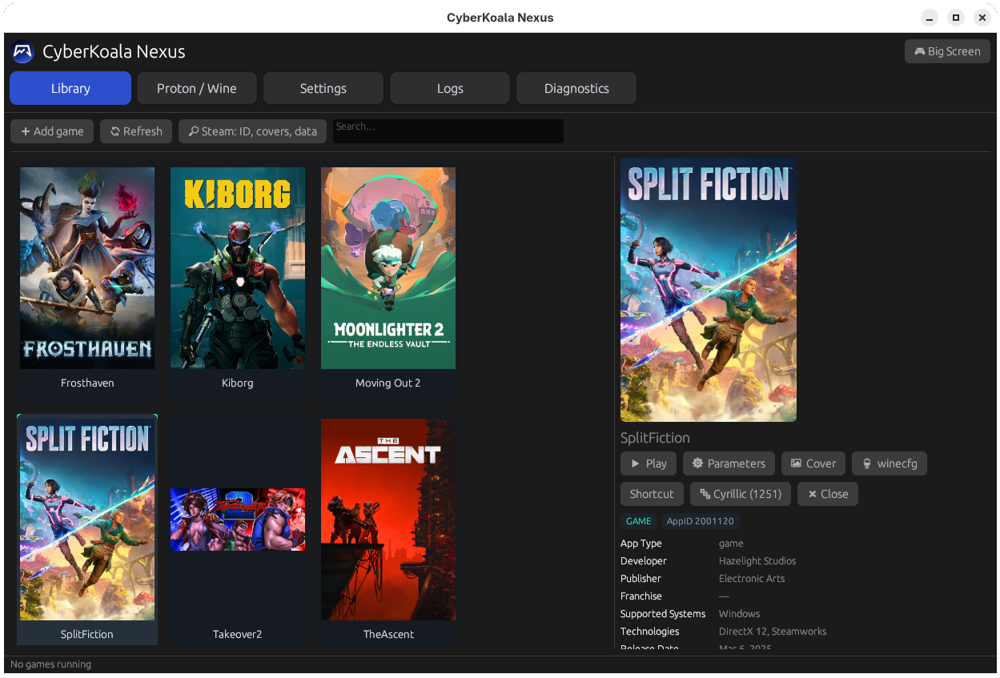
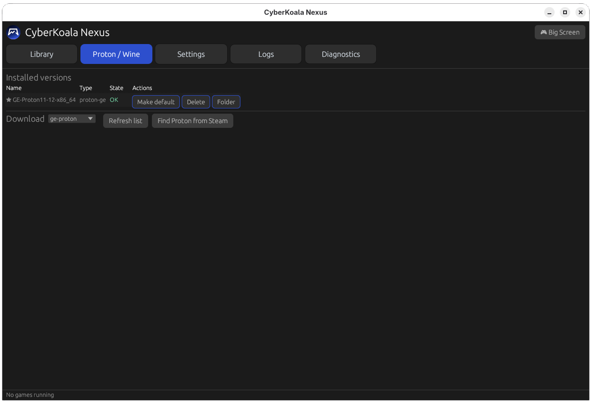
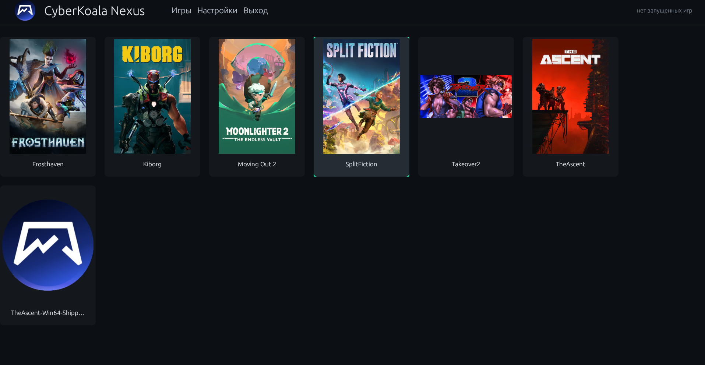

<h1 align="center">CyberKoala Nexus — Windows Game Launcher for Linux</h1>

<p align="center">
  <b>Run Windows games on Linux with a real Proton manager, per-game prefixes and NTFS-safe storage.</b><br>
  Built for ALT Linux (p11) · x86_64 · GE-Proton · Proton-CachyOS · Wine-GE · DXVK · VKD3D
</p>

<p align="center">
  <a href="https://github.com/CyberKoalaStudios/Nexus/releases/latest"></a>
  
  
</p>
 

<p align="center">
  <a href="#-install">Install</a> ·
  <a href="#-screenshots">Screenshots</a> ·
  <a href="#-proton-manager-ge-proton-vs-cachyos-vs-wine-ge">Proton versions</a> ·
  <a href="#-playing-games-from-an-ntfs-drive-on-linux">NTFS</a> ·
  <a href="#-faq">FAQ</a> ·
</p>

<p align="center">
  
</p>

---

**CyberKoala Nexus** is a free **game launcher for Linux** that runs your **Windows games** through Proton and Wine — without hand-editing `WINEPREFIX`, juggling `winecfg`, or losing settings when a drive letter changes.

One window holds your game library, every installed **Proton version**, an isolated **Wine prefix per game**, and the launch log. Games can live on any disk — including **NTFS** — while prefixes, Proton builds and configs always stay on your Linux system drive.

>  **Made for:** ALT Linux users with a Windows game library on a second disk.
> Steam already handles Steam games well — Nexus is for everything else.

##  Contents

- [Install](#-install)
- [Screenshots](#-screenshots)
- [Features](#-features)
- [Proton manager: GE-Proton vs CachyOS vs Wine-GE](#-proton-manager-ge-proton-vs-cachyos-vs-wine-ge)
- [Per-game settings: DXVK, VKD3D, FSR, HDR](#-per-game-settings-dxvk-vkd3d-fsr-hdr)
- [Playing games from an NTFS drive on Linux](#-playing-games-from-an-ntfs-drive-on-linux)
- [Big Screen mode](#-big-screen-mode-couch-gaming-on-linux)
- [How it works](#-how-it-works-one-core-no-gui-side-wine-calls)
- [File locations](#-file-locations)
- [Custom Proton sources](#-custom-proton-sources-sourcestoml)
- [FAQ](#-faq)
- [Troubleshooting](#-troubleshooting)
- [Roadmap](#-roadmap)
- [Contributing](#-contributing)

## Install

**Requirements:** ALT Linux p11 · x86_64 · glibc ≥ 2.38 · Vulkan 1.3 capable GPU · 512 MB RAM · ~2 GB for prefixes (plus your games).

### Option A — RPM package (ALT Linux, recommended)

Download `cyberkoala-nexus-X.X.X-alt1.x86_64.rpm` from the [latest release](https://github.com/CyberKoalaStudios/Nexus/releases/latest), then as root (`su -`):

```bash
apt-get update
# make sure to change X.X.X to latest release version
apt-get install cyberkoala-nexus-X.X.X-alt1.x86_64.rpm
```

Launch it:

```bash
cyberkoala-nexus
```

The package installs through APT-RPM and updates with the rest of your system.

### Option B — install script 

```bash
cd ~/Downloads
chmod +x nexusinstall.sh
./nexusinstall.sh
```

The script checks dependencies, prepares the data directory and adds the launcher to your application menu. It will ask for `sudo` when installing system packages.

> ALT Linux is the primary tested target. On other distros the script path is provided as-is — reports from Fedora / Arch / Ubuntu users are welcome in [Issues](https://github.com/CyberKoalaStudios/Nexus/issues).

### Option C — AppImage (other Linux distributions)

Download `CyberKoalaNexus-X.X.X-x86_64.AppImage` from the [latest release](https://github.com/CyberKoalaStudios/Nexus/releases/latest), then:

```bash
cd ~/Downloads
# make sure to change X.X.X to latest release version
chmod +x CyberKoalaNexus-X.X.X-x86_64.AppImage
# launch it
./CyberKoalaNexus-X.X.X-x86_64.AppImage
```


### First launch in 4 steps

1. **Install a Proton build** — open the Proton manager, click *Install* on GE-Proton (or CachyOS / Wine-GE).
2. **Add a game** — `+ Add game`, give it a name and the path to its `.exe`. Nexus assigns a UUID and creates a prefix on your system disk.
3. **Pick Proton + tweaks** — choose the build for this game, toggle env vars if needed.
4. **Press ▶ Launch** — and optionally create a `.desktop` shortcut to start it from your menu or desktop.

## Screenshots

| Game library | Proton manager |
|---|---|
| [](docs/screenshots/linux-game-launcher-library.png) | [](docs/screenshots/proton-manager-linux.png) |

**Big Screen mode** — a couch/TV interface for gamepad-first sessions:

[](docs/screenshots/linux-big-screen-mode.png)

##  Features

| | |
|---|---|
| Proton manager | Install, update, verify and remove GE-Proton, Proton-CachyOS, Proton Experimental, Steam Proton, Wine-GE and your own builds — from one panel. |
| One prefix per game | Isolated Wine/Proton prefixes. No DLL, registry or settings collisions between games. |
|  NTFS-safe by design | Games on NTFS, prefixes + Proton + configs on ext4/btrfs. Unplug the game disk and nothing is lost. |
|  Per-game launch options | Environment variables and compatibility flags per title: DXVK, VKD3D, FSR, NVAPI, HDR, esync/fsync. |
|  Big Screen mode | Gamepad-friendly interface for a TV or monitor-from-the-couch setup. |
|  Desktop shortcuts | `.desktop` launchers that go through the same Core and the same prefix. |
|  Portable configs | Each game exports to a single JSON file — move your setup between machines with the UUID intact. |
|  Editable sources | Download sources live in `sources.toml`, not in the code. Add a repo without rebuilding the app. |

## Proton manager: GE-Proton vs CachyOS vs Wine-GE

| Build | What it is | Good for |
|---|---|---|
| GE-Proton | GloriousEggroll's Proton fork with extra patches and media fixes | Problem titles, cutscenes, stubborn launchers |
| Proton-CachyOS | CachyOS performance-oriented Proton build | Squeezing out extra frames |
| Proton Experimental | Valve's rolling branch (via Steam) | Newest Valve fixes |
| Steam Proton | Proton shipped with your Steam install | Matching what Steam uses |
| Wine-GE | GloriousEggroll's Wine fork for non-Steam games | Standalone EXEs, installers, repacks |
| Custom | Any build you point at | Testing, patched or vendor builds |

- ★ marks the **default version** used for newly added games; every game can override it.
- Integrity check verifies installed builds against checksums (SHA-512 where the source publishes them).
- Removing a Proton build never touches your game prefixes.

Not sure which build a game needs? Check [ProtonDB](https://www.protondb.com/) reports, then switch the version in Nexus and relaunch — the prefix stays the same.

## Per-game settings: DXVK, VKD3D, FSR, HDR

Toggle environment variables per game instead of editing shell scripts:

| Variable | Effect |
|---|---|
| `VKD3D_CONFIG=dxr` | Enables DirectX Raytracing in VKD3D-Proton (needs an RT-capable GPU + driver) |
| `PROTON_ENABLE_NVAPI=1` | Exposes NVAPI — required for DLSS on NVIDIA |
| `WINE_FULLSCREEN_FSR=1` | Proton's fullscreen FSR upscaling (pair with `WINE_FULLSCREEN_FSR_STRENGTH`) |
| `PROTON_ENABLE_HDR=1` | HDR output on supported setups (experimental) |
| `DXVK_ASYNC=1` | Async shader compilation — **only works on DXVK builds that include the async patch** |
| `PROTON_NO_ESYNC=1` | Disables esync — useful when a game crashes on startup |

Every toggle is written to the game's config and applied by the Core at launch.

##  Playing games from an NTFS drive on Linux

Wine prefixes rely on symlinks, case-sensitive names and POSIX permissions that NTFS doesn't guarantee. Nexus splits the storage:

```
SYSTEM DISK (ext4 / btrfs)          GAME DISK (NTFS, EXT4, BTRFS external, anything)
~/.local/share/cyberkoala-nexus/    /mnt/ntfs-games/
├── nexus.db                        ├── Game1/
├── proton/                         ├── Game2/
├── prefixes/<uuid>/                └── Game3/
└── logs/
```

**Unplug the game disk:** games become temporarily unavailable, but prefixes, Proton builds, settings and database entries stay intact. Plug it back in and the library comes alive with the same UUIDs.

Recommended NTFS mount (kernel `ntfs3` driver):

```fstab
UUID=XXXX-XXXX  /mnt/ntfs-games  ntfs3  uid=1000,gid=1000,rw,nofail,windows_names  0 0
```

## Big Screen mode: couch gaming on Linux

A separate large-element interface for TVs and gamepad sessions — pick a game, launch, play. Same Core, same prefixes, same settings as the desktop view.

 
## FAQ

<details>
<summary><b>Can I run Windows games on ALT Linux?</b></summary>

Yes. ALT Linux ships Wine and Proton-compatible stacks, and Nexus manages them for you: install GE-Proton or Wine-GE, add the game's `.exe`, press Launch. Compatibility depends on the specific game and Proton build — check ProtonDB for reports.
</details>

<details>
<summary><b>Does it work with non-Steam games, repacks and GOG installers?</b></summary>

That's the main use case. Add any Windows executable — a game, an installer or a launcher — and Nexus creates a dedicated prefix for it. Wine-GE is often the best pick for standalone installers.
</details>

<details>
<summary><b>Do I need Steam installed?</b></summary>

Not for GE-Proton, Proton-CachyOS, Wine-GE or custom builds — they run standalone. The Steam Proton and Proton Experimental sources use your existing Steam installation.
</details>

<details>
<summary><b>Which Proton version should I use?</b></summary>

Start with the latest GE-Proton. If a game is slow, try Proton-CachyOS. For standalone installers try Wine-GE. Since each game has its own prefix and version, switching is a dropdown, not a migration.
</details>

<details>
<summary><b>Will games with anti-cheat work?</b></summary>

Some do, many don't. Easy Anti-Cheat and BattlEye work only in titles where the developer enabled Proton support; kernel-level anti-cheat (e.g. Vanguard) does not work under Wine/Proton at all. This is a Proton/Wine limitation, not a launcher one — check ProtonDB before installing.
</details>

<details>
<summary><b>Where are my saves?</b></summary>

Inside the game's prefix under `~/.local/share/cyberkoala-nexus/prefixes/<uuid>/`, in the usual Windows paths (`drive_c/users/steamuser/Documents`, `AppData`, etc.). Back up that folder to back up the game's saves and settings.
</details>

<details>
<summary><b>What happens if I move a game or reinstall Linux?</b></summary>

Moving a game: update the path — the UUID keeps prefix, settings and shortcuts attached. Reinstalling: copy `~/.local/share/cyberkoala-nexus/` and `~/.config/cyberkoala-nexus/` to the new system.
</details>

<details>
<summary><b>Does it support Steam Deck / SteamOS?</b></summary>

Not a target platform right now. Nexus targets x86_64 desktop Linux with ALT Linux as the primary distribution. Big Screen mode gives a couch-friendly UI on desktop setups.
</details>

<details>
<summary><b>Is it free?</b></summary>

Yes — free to use. See [LICENSE](LICENSE).
</details>

## Troubleshooting

| Symptom | Try this |
|---|---|
| Game doesn't start | Read the launch log in Nexus, then switch to another Proton build (GE-Proton first) |
| `E_NO_PROTON` | Install at least one build in the Proton manager |
| `E_DISK_OFFLINE` | The game disk isn't mounted — mount it and relaunch; your settings are safe |
| No Vulkan / DXVK errors | Install Vulkan drivers (`vulkaninfo` should list your GPU), including 32-bit libs |
| Crash right at startup | Try `PROTON_NO_ESYNC=1`, or a fresh prefix for that game |
| Stutter on first run | Shader compilation — it settles after a few minutes of play |
| NTFS permission errors | Mount with `uid=`/`gid=` matching your user (see the fstab example above) |

Bug reports with the launch log attached are hugely appreciated → [Issues](https://github.com/CyberKoalaStudios/Nexus/issues).

## 📄 License

See [LICENSE](LICENSE).

## Credits

[GloriousEggroll](https://github.com/GloriousEggroll) (GE-Proton, Wine-GE) · [CachyOS](https://github.com/CachyOS) (Proton-CachyOS) · [Valve](https://www.valvesoftware.com/) (Proton) · [WineHQ](https://www.winehq.org/) · the ALT Linux community.

Proton™ is a trademark of Valve Corporation. This project is not affiliated with or endorsed by Valve. Game titles are mentioned as examples; all trademarks belong to their owners.

---


<a href="https://www.producthunt.com/products/cyberkoala-nexus?embed=true&amp;utm_source=badge-featured&amp;utm_medium=badge&amp;utm_campaign=badge-cyberkoala-nexus" target="_blank" rel="noopener noreferrer"></a>

<p align="center">
  <b>Play your Windows library on Linux.</b><br>
  <a href="https://github.com/CyberKoalaStudios/Nexus/releases/latest">⬇ Download CyberKoala Nexus</a> ·
  <a href="https://nexus.cyberkoala.ru">🌐 Nexus</a>
</p>

<p align="center">⭐ Star the repo if it saved you an evening of winecfg.</p>
